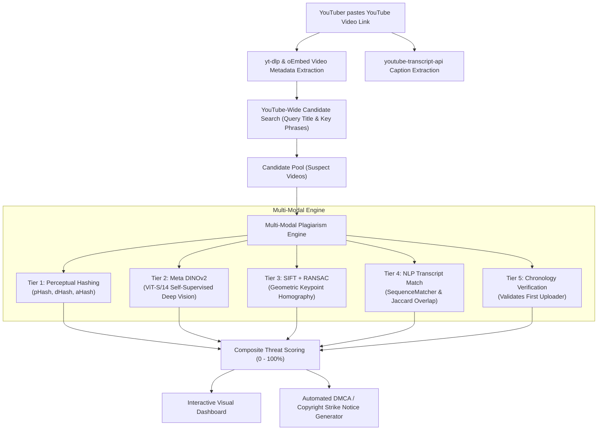

# 🛡️ PlagiGuard YT — YouTube Content Plagiarism & AI-Ripoff Detector

[](https://omanushoriginal.github.io/plagiariser_detector/)
[](https://python.org)
[](https://fastapi.tiangolo.com)
[](https://pytorch.org)
[](https://opencv.org)
[](LICENSE)
[](https://github.com/omanushoriginal)

> **A forensic AI suite and web application built specifically for YouTube creators to uncover stolen thumbnails, AI-stylized image copies, paraphrased/stolen voiceover scripts, and duplicate video re-uploads across YouTube.**

---

## 🌐 Live Website & Demo

Experience the interactive frontend directly hosted on GitHub Pages:
🔗 **[https://omanushoriginal.github.io/plagiariser_detector/](https://omanushoriginal.github.io/plagiariser_detector/)**

---

## 🎯 The Problem Solved

Every day, content creators have their hard work stolen by unscrupulous channels and automated content farms:
1. **Thumbnail Thieves**: Recompressing, cropping, or applying slight color shifts to steal high-CTR thumbnails.
2. **AI-Modified Ripoffs**: Running an original creator's thumbnail through Midjourney/Stable Diffusion (img2img) to bypass simple reverse-image searches while stealing the exact visual layout.
3. **Script Re-readers**: Copying an original creator's narration word-for-word or using AI rephrasers while retaining the exact chapter flow.
4. **Direct Video Clones**: Re-uploading whole segments of videos.

**PlagiGuard YT** solves this by letting YouTubers input any YouTube video link. The system extracts metadata and captions, autonomously searches YouTube for suspect videos, executes multi-modal AI comparisons, and outputs an irrefutable **DMCA / Copyright Infringement Evidence Report**.

---

## 🔬 Multi-Modal Forensic Architecture



### Detection Tiers:
| Tier | Technique | What It Catches |
| :--- | :--- | :--- |
| **Tier 1** | **Perceptual Hashing (pHash, dHash, aHash)** | Bit-exact re-uploads, crops, resolution scaling, and compression artifacts. |
| **Tier 2** | **Meta DINOv2 (ViT-S/14)** | AI-modified/restyled images (Midjourney, img2img), face swaps, and painted-over artwork. |
| **Tier 3** | **SIFT + RANSAC Homography** | Replaced background elements with identical foreground compositions and landmark placements. |
| **Tier 4** | **Script Sequence Alignment** | Verbatim narration theft, subtitle re-use, and chapter-by-chapter script paraphrasing. |
| **Tier 5** | **Chronological Provenance** | Upload dates to conclusively establish who published the original first. |

---

## ✨ Features

- 🔍 **YouTube-Wide Auto Scan**: Paste one link, and the engine searches YouTube for potential clones and runs comparative diagnostics.
- ⚔️ **1-on-1 Video Matcher**: Enter your video and a specific suspect's link to generate an in-depth forensic proof sheet.
- 🖼️ **Side-by-Side Thumbnail Inspector**: Direct visual comparison highlighting differences, pHash hamming distance, and DINOv2 structural similarity.
- 🎙️ **Transcript & Audio Script Analysis**: Compares spoken words and timestamps across videos.
- ⚖️ **Instant DMCA Notice Generator**: 1-click generation of legally structured copyright takedown notices containing forensic hashes, timestamp alignments, and URLs ready for YouTube Studio.
- ⚡ **Lightning Fast**: Highly optimized image resizing and batch inference; completes scans across multiple candidates in seconds.
- 📱 **Modern Responsive Cyber UI**: Dark-themed dashboard designed for desktop and mobile creators.

---

## 🚀 Quickstart Guide

### 1. Clone the Repository
```bash
git clone https://github.com/omanushoriginal/plagiariser_detector.git
cd plagiariser_detector
```

### 2. Install Dependencies
```bash
pip install -r requirements.txt
```

### 3. Run the Web Application
**On Windows:**
Double-click `run.bat` or execute:
```powershell
python app.py
```

**On Linux / macOS:**
```bash
chmod +x run.sh
./run.sh
```

### 4. Open in Your Browser
Navigate to:
```
http://localhost:8000
```

---

## 🐳 Docker Deployment

Run PlagiGuard YT in an isolated Docker container with one command:

```bash
docker compose up --build
```
The server will be available at `http://localhost:8000`.

---

## 📡 REST API Documentation

### 1. Scan YouTube for Duplicates
- **Endpoint**: `POST /api/scan`
- **Request Body**:
  ```json
  {
    "url": "https://www.youtube.com/watch?v=_uQrJ0TkZlc",
    "max_candidates": 6,
    "use_dinov2": true
  }
  ```
- **Response**:
  ```json
  {
    "status": "success",
    "scan_time_sec": 4.12,
    "source_video": { ... },
    "candidates_count": 6,
    "highest_plagiarism_risk_pct": 94.2,
    "matches": [ ... ]
  }
  ```

### 2. Compare Two Videos (1-on-1)
- **Endpoint**: `POST /api/compare`
- **Request Body**:
  ```json
  {
    "url1": "https://www.youtube.com/watch?v=ORIGINAL_ID",
    "url2": "https://www.youtube.com/watch?v=SUSPECT_ID",
    "use_dinov2": true
  }
  ```

### 3. Instant Sample Case Data
- **Endpoint**: `GET /api/sample`
- Returns verified demo cases (identical re-upload, AI-remixed thumbnail, script paraphrase, original video) for testing without YouTube scraping delays.

### 4. Health Check
- **Endpoint**: `GET /api/health`

---

## 📂 Repository Structure

```
plagiariser_detector/
├── .github/
│   └── workflows/
│       └── pages.yml          # Automated GitHub Pages deployment
├── docs/                      # Static web deployment for GitHub Pages
│   ├── index.html
│   ├── style.css
│   └── app.js
├── static/                    # FastAPI served frontend assets
│   ├── index.html
│   ├── style.css
│   └── app.js
├── app.py                     # FastAPI web server and REST API
├── detector.py                # YouTube scraper, candidate search, and scoring pipeline
├── functions.py               # Deep computer vision (DINOv2, SIFT, pHash, Whisper)
├── requirements.txt           # Python package dependencies
├── Dockerfile                 # Container specification
├── docker-compose.yml         # Container orchestration
├── run.bat                    # 1-click Windows launcher
├── run.sh                     # 1-click Unix launcher
├── LICENSE                    # MIT License
└── README.md                  # Documentation and project manual
```

---

## 👤 Author & Contact

- **Author**: **omanushoriginal**
- **GitHub**: [@omanushoriginal](https://github.com/omanushoriginal)
- **Email**: [drisham4@gmail.com](mailto:drisham4@gmail.com)
- **Repository**: [https://github.com/omanushoriginal/plagiariser_detector](https://github.com/omanushoriginal/plagiariser_detector)

---

## ⚖️ License

Distributed under the **MIT License**. See [`LICENSE`](LICENSE) for details.
